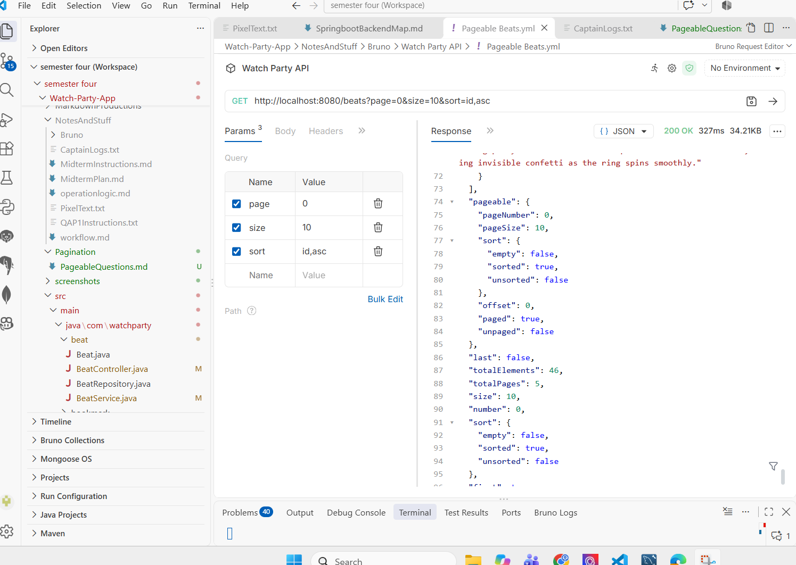
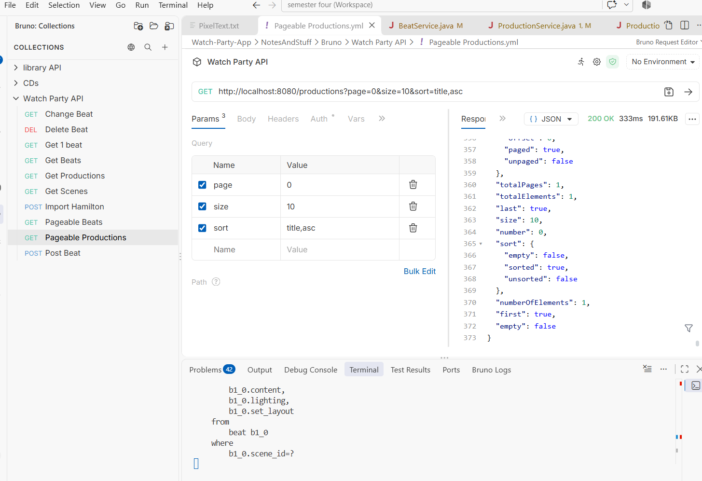

# Answers to the Pagination Questions

## Q1. Which two endpoints did you add pagination to, and why did those make sense to paginate?

I added pagination to `GET /beats` and `GET /productions`.

These two endpoints make sense to paginate because both collections can grow large over time. A production may have many scenes and beats, and the database can eventually contain many productions. 

If the API returned every record in one response, the client would receive a huge payload, the server would do more work, and the response would be harder to use. Pagination lets the API split the data into smaller chunks.

## Q2. Show a Postman (Bruno) request that uses pagination and sorting (Show a screenshot from postman when you test)

## Q3. In your own code, what does the `Pageable` parameter do in your repository or controller? Paste the relevant method signature and explain it.

public Page<Beat> getAllBeats(Pageable pageable)     

The `Pageable` object is creates smaller chunks defined by the user
For example:
?page=0&size=10&sort=id,asc
means:
- `page=0` = first page
- `size=10` = 10 records per page
- `sort=id,asc` = sort by `id` in ascending order

So the `Pageable` parameter tells Spring Data JPA exactly how the data should be retrieved from the database. 

## Q4. What is the difference between `Page<T>` and `List<T>` as a return type? Why might you choose one over the other?

A `List<T>` is just a flat collection of objects. 

This is straightforward, but it does not include any pagination metadata.

A `Page<T>` is a Spring Data type that wraps the list of results and adds metadata such as:
- current page number
- page size
- total number of elements
- total pages
- whether there is another page

I would choose `Page<T>` when the endpoint can return a large number of records and I want the client to know how many results are available and how to request the next chunk. 

I would choose `List<T>` when the dataset is small and I do not need pagination information or paging behavior.

In this project, `Page<T>` is the better choice because the API is returning list-style data from a database that may grow over time.

